<a href="README.md">English</a> | <b>हिन्दी</b> | <a href="README.ur.md">اردو</a>

<h1 align="center">
<picture>
<source media="(prefers-color-scheme: dark)" srcset="assets/readme/hero-dark.svg">

</picture>
</h1>

आदतें, काम और नोट्स एक शांत ऐप में। सब कुछ आपके फ़ोन पर रहता है।

> [!NOTE]
> **स्थिति: प्री-रिलीज़।** अभी कोई टैग किया हुआ रिलीज़ नहीं है। Android बिल्ड CI से बनता है और असली फ़ोन पर जाँचना बाकी है।

## यह क्या है

Poswal Orbit, Flutter से बना ऑफ़लाइन-फ़र्स्ट Android ऐप है। इसमें आपकी आदतें, आपके काम और आपके नोट्स एक ही जगह रहते हैं। कोई अकाउंट, साइन-इन या सर्वर नहीं है।

आदतें आपकी भीतरी कक्षा हैं। काम बाहरी कक्षा हैं। नोट्स वह गुरुत्वाकर्षण हैं जो पूरे दिन को थामे रखता है।

## क्यों Orbit

- **दिन सुबह 4:00 बजे शुरू होता है।** रात में 4 बजे से पहले किया गया चेक-इन पिछले दिन में गिना जाता है।
- **यह ऑफ़लाइन चलता है।** न कुछ सिंक करना है, न किसी का इंतज़ार।
- **हफ़्ते की समीक्षा उत्साह बढ़ाने वाले शब्दों में होती है।**

## सुविधाएँ

- **आज।** प्रगति रिंग दिखाता है कि दिन का कितना हिस्सा पूरा हुआ। आज की आदतें और काम एक ही सूची में हैं।
- **आदतें।** हाँ या ना वाली और संख्या वाली आदतें। पिछले 14 हफ़्तों का हीटमैप। स्ट्रीक फ़्रीज़ छूटे हुए दिन को बचा सकता है।
- **काम।** साधारण वाक्य से जोड़ें, जैसे `Pay rent tomorrow 4pm !high #home`। सूचियाँ: Today, Upcoming, All और Done। सबटास्क और दोहराव।
- **नोट्स।** मार्कडाउन एडिटर जो टाइप करते समय शैली दिखाता है। चेकलिस्ट, रंग टैग, और आदतों, कामों व नोट्स में एक खोज।

पूरी सूची के लिए [English README](README.md#features) देखें।

## निजता

- ऐप कुछ भी इकट्ठा नहीं करता। कोई अकाउंट, एनालिटिक्स, विज्ञापन या क्रैश रिपोर्टिंग नहीं है।
- रिलीज़ बिल्ड `INTERNET` अनुमति नहीं माँगते। डिबग और CI टेस्ट बिल्ड माँग सकते हैं।
- डेटा फ़ोन से तभी बाहर जाता है जब आप उसे खुद शेयर करें।

पूरा पाठ [PRIVACY.md](PRIVACY.md) में है (अंग्रेज़ी में)।

## भाषाएँ

English, हिन्दी और اردو। उर्दू में लेआउट दाएँ से बाएँ चलता है। भाषा बदलने के लिए **Settings > Language** खोलें।

## इंस्टॉल

अभी रिलीज़ APK नहीं है। वह v1.0.0 के साथ आएगा। तब तक CI का डिबग बिल्ड इंस्टॉल करें:

1. [Actions टैब](https://github.com/officialtofeekposwal/poswal-orbit/actions) खोलें और सबसे नया सफल रन चुनें।
2. `poswal-orbit-debug-apk` आर्टिफ़ैक्ट डाउनलोड करके unzip करें। आपको `app-debug.apk` मिलेगी।
3. फ़ाइल को फ़ोन में कॉपी करें।
4. Android पूछे तो अपने फ़ाइल मैनेजर या ब्राउज़र को इंस्टॉल की अनुमति दें।
5. फ़ाइल पर टैप करके Install चुनें।

पूरी विधि [docs/INSTALL_DEBUG_APK.md](docs/INSTALL_DEBUG_APK.md) में है।

## स्थिति

| क्षेत्र | स्थिति |
| :--- | :--- |
| Android डिबग बिल्ड (CI) | बन गया, स्वचालित टेस्ट पास |
| Android रिलीज़ बिल्ड | CI में बन गया, फ़ोन पर जाँच बाकी |
| असली फ़ोन पर जाँच | जारी है |
| रिमाइंडर, अलार्म, विजेट | लिखे गए हैं, अभी किसी डिवाइस पर जाँचे नहीं गए |
| iOS | कोड लिखा है, जाँचा नहीं गया (Mac उपलब्ध नहीं) |
| Play Store | प्रकाशित नहीं |

## योगदान और लाइसेंस

बिल्ड, आर्किटेक्चर और टेस्ट की जानकारी [English README](README.md#build-from-source) में है। शुरुआत के लिए [docs/GOOD_FIRST_ISSUES.md](docs/GOOD_FIRST_ISSUES.md) और [CONTRIBUTING.md](CONTRIBUTING.md) देखें।

Poswal Orbit [MIT लाइसेंस](LICENSE) के तहत जारी है।
