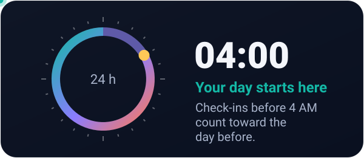

<p align="center"><b>English</b> | <a href="README.hi.md">हिन्दी</a> | <a href="README.ur.md">اردو</a></p>

<h1 align="center">
<picture>
<source media="(prefers-color-scheme: dark)" srcset="assets/readme/hero-dark.svg">

</picture>
</h1>

<p align="center">
Habits, tasks and notes in one calm app. Everything stays on your phone.
</p>

<p align="center">
<a href="https://github.com/officialtofeekposwal/poswal-orbit/actions/workflows/ci.yml"></a>
<a href="LICENSE"></a>


</p>

<p align="center">
<a href="#why-orbit">Why Orbit</a> ·
<a href="#features">Features</a> ·
<a href="#privacy">Privacy</a> ·
<a href="#languages">Languages</a> ·
<a href="#install">Install</a> ·
<a href="#status">Status</a> ·
<a href="#build-from-source">Build</a> ·
<a href="#contributing">Contribute</a>
</p>

> [!NOTE]
> **Status: pre-release.** Poswal Orbit has no tagged release yet. The Android build is made by CI and still needs checking on a real phone. See [Status](#status) for the full picture.

## What it is

Poswal Orbit is an offline-first app for Android, built with Flutter. It keeps your habits, your tasks and your notes in one place. There is no account, no sign-in and no server.

Habits are your inner orbit. Tasks are your outer orbit. Notes are the gravity that holds the day together.

<p align="center"></p>

## Why Orbit

<p align="center"></p>

- **The day starts at 4:00 AM.** A check-in at 1:30 AM counts toward the day before, so a late night does not break a streak.
- **It works offline.** There is nothing to sync and nothing to wait for.
- **It stays calm.** Weekly reviews use encouraging wording, and insights stay quiet until there is enough history to say something real.

## Screens

<p align="center">




</p>

*Illustration, not a screenshot. Real phone screenshots will replace these after verification on a device.*

<p align="center"></p>

## Features

### Today



- A progress ring shows how much of the day is done.
- Scheduled habits and tasks due today share one list.
- A floating glass tab bar sits at the bottom of the screen.

### Habits



- Two habit types: yes or no, and numeric.
- Schedules: daily, weekdays, times per week, times per month, or every N days.
- A consistency score that weighs recent days more than old ones, so one miss does not erase a long run.
- A streak freeze can cover a missed scheduled day.
- A heatmap of the past 14 weeks.
- Drag to reorder.

### Tasks



- Quick add understands plain sentences, such as `Pay rent tomorrow 4pm !high #home`.
- Smart lists: Today, Upcoming, All and Done.
- Subtasks, and repeats: daily, weekdays, weekly, monthly, custom, or after completion.
- Drag to reorder.

### Notes


- A markdown editor that styles text as you type and dims the syntax marks.
- A toolbar for headings, bold, italic, bullets and checklists. It keeps the keyboard open while you format.
- Tap a checkbox on a note card to tick it off.
- Color tags, and one search across habits, tasks and notes.

<details>
<summary>More features</summary>

- **Insights.** A weekly review, your best weekday, and a link between habits and finished tasks once you have 14 days of history.
- **Share card.** The weekly review can be shared as an image through the system share sheet.
- **Themes.** Dark, light and true black for OLED screens.
- **Reminders.** Local notifications scheduled on a rolling 7-day window, with a health check screen in Settings.
- **Android widgets.** Three home screen widgets for today, habits and tasks. Not yet verified on a real device.
- **Data tools.** JSON backup and restore, CSV export for habits, tasks and notes, and paste-in import of JSON or Loop Habit Tracker CSV.
- **Design playground.** A hidden screen with the design system components. It is unlocked from the About section of Settings.

</details>

<p align="center"></p>

## Privacy



**What the app collects:** nothing. There are no accounts, no analytics, no ads and no crash reporting. Your data lives in a local SQLite database on your phone.

**What the app does not do:** it does not send your habits, tasks or notes anywhere.

- Release builds do not request the `INTERNET` permission.
- Debug and CI test builds may request it. Flutter adds it to debug builds for development tools.
- Other permissions are for reminders: notifications, exact alarms, vibration and start-up after reboot.
- Each day, the first time you open the app, a backup is written to its own storage. The last 7 are kept.
- A safety snapshot is taken before a restore and before wiping all data. A copy of the database is also taken before a schema migration.
- Data leaves the phone only when you share it, for example through the system share sheet.

Read the full text in [PRIVACY.md](PRIVACY.md).

## Languages



English, हिन्दी and اردو. Urdu uses a true right-to-left layout. Fonts are bundled in the app (Noto Sans Devanagari and Noto Nastaliq Urdu), so nothing is downloaded. Change the language in **Settings > Language**.

<p align="center"></p>

## Install

There is no release APK yet. It arrives with v1.0.0. Until then, install the CI debug build:

1. Open the [Actions tab](https://github.com/officialtofeekposwal/poswal-orbit/actions) and pick the latest successful run.
2. Download the `poswal-orbit-debug-apk` artifact and unzip it to get `app-debug.apk`.
3. Copy the file to your phone.
4. Allow installs from your file manager or browser when Android asks.
5. Tap the file and choose Install.

The full walkthrough, with notes for Samsung phones, is in [docs/INSTALL_DEBUG_APK.md](docs/INSTALL_DEBUG_APK.md). A debug build is larger and slower than a release build, and it may request the `INTERNET` permission.

## Status

| Area | State |
| :--- | :--- |
| Android debug build (CI) | Built, automated tests pass |
| Android release build | Built in CI, awaiting phone verification |
| Real-phone verification | In progress |
| Reminders, alarms, widgets | Written, not yet verified on a device |
| iOS | Code written, not verified (no Mac available) |
| Play Store | Not published |

The iOS notes are in [docs/IOS_STATUS.md](docs/IOS_STATUS.md). Release steps are in [docs/RELEASING.md](docs/RELEASING.md).

| Next | State |
| :--- | :--- |
| Phone verification | In progress |
| v1.0.0 tag and release APK | After phone verification |
| Real screenshots | After phone verification |
| iOS home screen widget | Open for contributors |
| Tablet layouts | Open for contributors |

<p align="center"></p>

## Build from source

<details>
<summary>Setup and commands</summary>

You need:

- Flutter 3.50.1, the version CI uses. Dart SDK `^3.14.0` is required by `pubspec.yaml`.
- JDK 21 and the Android SDK, as used in CI.
- For iOS only: a Mac with Xcode. See [docs/IOS_STATUS.md](docs/IOS_STATUS.md).

```bash
git clone \
  https://github.com/officialtofeekposwal/poswal-orbit.git
cd poswal-orbit
flutter pub get
dart run build_runner build \
  --delete-conflicting-outputs
flutter run
```

The build runner step generates the Drift database code. On Windows, see [docs/WINDOWS_SETUP.md](docs/WINDOWS_SETUP.md) for Smart App Control and ADB tips.

</details>

<details>
<summary>Architecture and design system</summary>

```text
lib/
  core/       design tokens, glass widgets, theme
  data/       Drift database, repositories, services
  domain/     pure Dart logic and models
  features/   today, habits, tasks, notes,
              insights, search, settings,
              onboarding, playground, shell
  l10n/       English, Hindi and Urdu strings
```

| Package | Version |
| :--- | :--- |
| flutter_riverpod | ^3.5.0 |
| go_router | ^18.1.4 |
| drift, drift_flutter | ^2.35.4, ^0.3.1 |
| flutter_local_notifications | ^23.0.3 |
| home_widget | ^0.10.0 |
| share_plus | ^13.3.1 |
| phosphoricons_flutter | ^1.1.1 |

The streak, score, schedule, quick-add and insight logic is plain Dart with no Flutter imports, which keeps it easy to test.

**Design system.** Tokens live in `lib/core/theme/poswal_tokens.dart`. The palette is teal `#14B8A6`, violet `#8B7CFF`, coral `#FF7A59` and gold `#FFC857`, on ink `#070B14` and a dark surface `#0F1626`. Surfaces use frosted glass with hairline borders. The background aurora is a painted gradient, not a shader. It shows a still frame when the system asks to reduce motion, and it is off in true black mode.

</details>

<details>
<summary>Testing</summary>

The suite declares 228 test cases across 39 files, counted from the source. Run it for the live result:

```bash
flutter analyze
flutter test --no-test-assets
```

CI runs both commands on every push and pull request to `main`.

</details>

<details>
<summary>More documents</summary>

- [CHANGELOG.md](CHANGELOG.md)
- [docs/PERFORMANCE.md](docs/PERFORMANCE.md)
- [docs/RELEASING.md](docs/RELEASING.md)
- [Store listing in English](docs/store/en.md), [Hindi](docs/store/hi.md) and [Urdu](docs/store/ur.md)
- [SECURITY.md](SECURITY.md) and [CODE_OF_CONDUCT.md](CODE_OF_CONDUCT.md)

</details>

## Contributing

Start with [docs/GOOD_FIRST_ISSUES.md](docs/GOOD_FIRST_ISSUES.md), then read [CONTRIBUTING.md](CONTRIBUTING.md). Before you open a pull request, run `flutter analyze` and `flutter test --no-test-assets`.

## License and credits

Poswal Orbit is released under the [MIT License](LICENSE).

- Fonts: Plus Jakarta Sans, Inter, Noto Sans Devanagari and Noto Nastaliq Urdu, all under the SIL Open Font License 1.1.
- Icons: [Phosphor Icons](https://phosphoricons.com) (MIT) through the `phosphoricons_flutter` package.
- The consistency score is inspired by Loop Habit Tracker.
- Design tokens and curves draw on [super-apple-design](https://github.com/officialtofeekposwal/super-apple-design).
