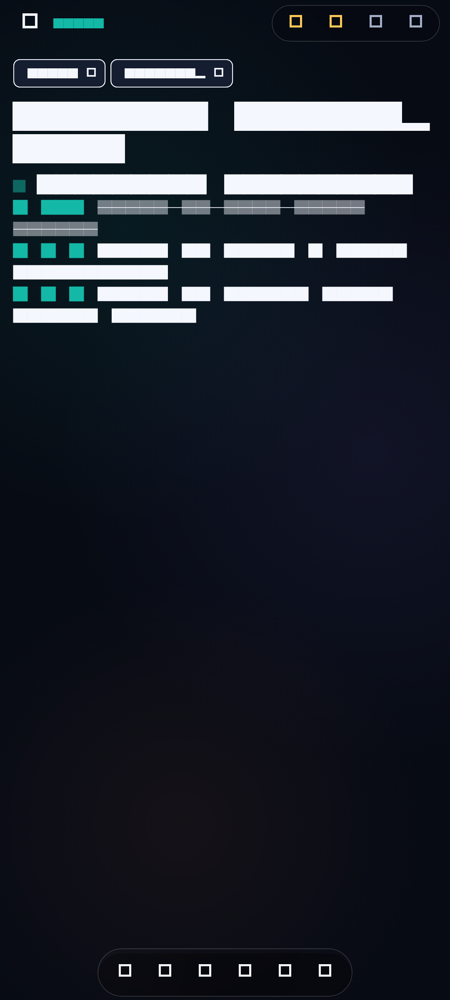
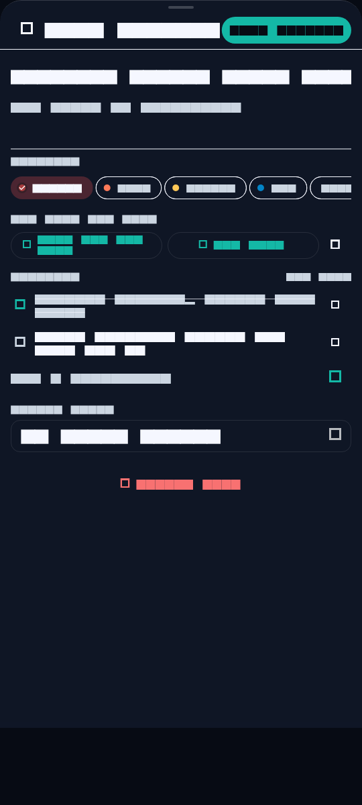
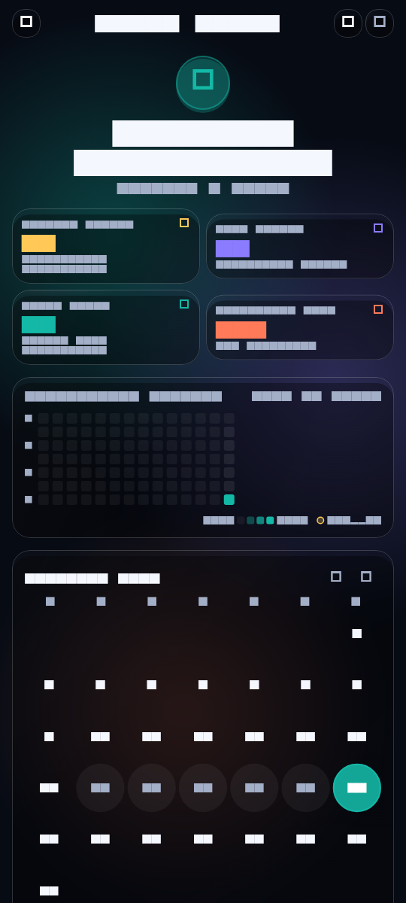
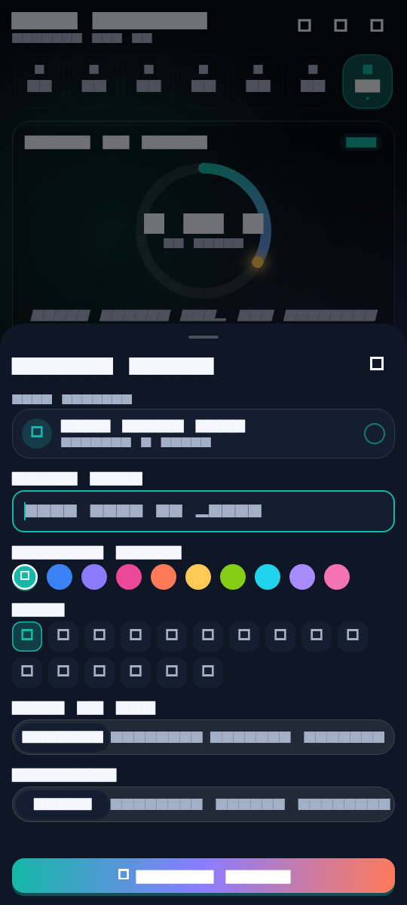

<p align="center">
  
</p>

<p align="center">
  <strong>Your whole day, in orbit.</strong><br>
  <em>Habits. Tasks. Notes. One calm, beautiful place.</em>
</p>

<p align="center">
  <a href="LICENSE"></a>
  <a href="https://flutter.dev"></a>
  <a href="https://github.com/officialtofeekposwal/poswal-orbit/actions"></a>
  <a href="https://github.com/officialtofeekposwal/poswal-orbit"></a>
</p>

---

## 🌟 Overview

**Poswal Orbit** is an all-in-one, 100% offline-first productivity application for **iOS** and **Android**, built with Flutter. It brings daily habit tracking, task management, and markdown notes together into a unified, calm workspace rendered with a modern **Liquid Glass** aesthetic.

### Why Poswal Orbit?
- **Unified Today Screen**: Track today's habits, overdue/upcoming tasks, and pinned notes all in one glance.
- **Liquid Glass Aesthetic**: Translucent refractive surfaces floating over a soothing aurora gradient on Ink (`#070B14`), Mist (`#F4F6FB`), or true OLED Black (`#000000`).
- **Privacy First & Offline Always**: No accounts, no cloud sync required, zero analytics, zero telemetry. Your data stays on your device.
- **Streak Preservation**: Streak freezes, auto-backups, and non-destructive schedule handling so you never lose your progress.
- **Intelligent Habit Scoring**: Exponentially weighted moving average (EWMA) habit consistency scoring beyond simple streak counters.
- **Natural Language Quick Add**: Add tasks swiftly like `"Call mom tomorrow 6pm !high #family"`.

---

## 📱 Screenshots

### Phase 3 & 3B: Notes Workspace, Rich Markdown Editor & Global Search
| Notes Grid (Pinned & Tags) | Full-Screen Markdown Editor | Unified Global Search |
| :---: | :---: | :---: |
|  |  |  |

### Phase 2 & 2B: Tasks Management & Natural Language Quick-Add
| Tasks List (Filters & Projects) | Natural Language Quick-Add | Full Task Detail Sheet |
| :---: | :---: | :---: |
|  |  |  |

### Phase 1 & 1.5: Today Hub, Habits Core & Habit Analytics
| Today Hub (Dark with Tasks) | Habit Detail (Dark) | Check-in Action Sheet | Habits Management |
| :---: | :---: | :---: | :---: |
|  |  |  |  |

| Today Hub (Light) | Create Habit Sheet |
| :---: | :---: |
|  |  |

<details>
<summary><strong>View Phase 0 Design Playground Screenshots</strong></summary>

| Dark Theme (`#070B14`) | Light Theme (`#F4F6FB`) | OLED Black (`#000000`) |
| :---: | :---: | :---: |
|  |  |  |

</details>

---

## 🛠️ Tech Stack & Architecture

- **Framework**: [Flutter](https://flutter.dev) (Impeller GPU engine enabled on iOS and Android)
- **State Management**: [Riverpod](https://riverpod.dev)
- **Local Database**: [Drift](https://drift.simonbinder.eu) (SQLite with transactional migrations)
- **Routing**: [go_router](https://pub.dev/packages/go_router)
- **Data Serialization**: [Freezed](https://pub.dev/packages/freezed) & [json_serializable](https://pub.dev/packages/json_serializable)
- **Local Notifications**: `flutter_local_notifications` + `timezone` (rolling 64-notification window)
- **Security & Privacy**: `local_auth` (Biometrics), `flutter_secure_storage`
- **Design System**: Custom `AppGlass` wrappers based on `poswal_tokens.dart` with multi-tier graceful degradation.

---

## 🚀 Getting Started

### Prerequisites
- [Flutter SDK](https://docs.flutter.dev/get-started/install) (3.24+ recommended)
- Android Studio with Android SDK 34+ (for Android builds)
- Xcode 15+ & CocoaPods on macOS (for iOS builds)
*(Windows developers: see [docs/WINDOWS_SETUP.md](docs/WINDOWS_SETUP.md) for Windows 11 Smart App Control & ADB setup tips).*

### Installation & Run

1. **Clone the repository:**
   ```bash
   git clone https://github.com/officialtofeekposwal/poswal-orbit.git
   cd poswal-orbit
   ```

2. **Verify your development environment:**
   ```bash
   flutter doctor
   ```

3. **Install dependencies:**
   ```bash
   flutter pub get
   ```

4. **Run code generation (models & database):**
   ```bash
   dart run build_runner build --delete-conflicting-outputs
   ```

5. **Launch the application:**
   ```bash
   flutter run
   ```

---

## 🗺️ Project Roadmap

- [x] **Phase 0: Foundation & Look** — Project setup, design tokens, aurora background, glass wrappers, and Design Playground screen.
- [x] **Phase 1: Habits Core & Today Hub** — Drift database schema v1, pure Dart domain engines (streaks, EWMA score, schedule, date boundary), Today progress ring, habits management, step-by-step creation sheet, and floating glass tab bar.
- [x] **Phase 1.5: Habit Detail & Analytics** — Hero stats (current/best streak, EWMA score, completion rate), 14-week GitHub heatmap, interactive monthly calendar with past days editing, weekly performance bars, consistency trend line, long-press check-in sheet (numeric +/- stepper, skip, notes), and reorderable habits with streak freeze.
- [x] **Phase 2: Tasks System** — Smart lists (Today, Upcoming, All, Done), priorities (Urgent, High, Medium, Low), subtasks checklist, recurrence rules, and live NLP quick-add.
- [x] **Phase 3: Notes & Global Search** — Markdown-lite notes editor with floating glass toolbar, autosave engine, checklist toggling, pins, color tags, RTL support (Urdu/Hindi), and unified multi-entity global search.
- [x] **Phase 4: Data Safety & Notifications** — 7-day automatic backup rotation, full JSON & CSV import/export, Loop Habit Tracker migration, Settings screen, battery-safe 7-day rolling notifications engine, exact alarms, boot/timezone reschedule receiver, and Reminders Health Check.
- [x] **Phase 5A: Insights & Multilingual Localization** — Weekly review card (non-guilt copy, habits/tasks/best streak), pure Dart productivity scoring ($60\%$ habits + $40\%$ tasks), peak momentum timing (best weekday & peak window), habit-vs-task correlation ($\ge 14$ days guardrail), shareable stats image rendering (`share_plus`), and complete native localization for English, Hindi (Noto Sans Devanagari), and Urdu (Noto Nastaliq Urdu with RTL text direction).
- [x] **Phase 5B: Widgets, App Security & Privacy Guard** — Home screen glance widgets (Android `AppWidgetProvider` with background interactive check-in), biometric app lock (Fingerprint/Face/Passcode fallback with configurable auto-lock timeout), and Android `FLAG_SECURE` recent apps privacy guard.
- [x] **Phase 6: Polish & Release** — Transactional SQLite migrations with `SAVEPOINT` rollback, full screen-reader accessibility semantics (`Semantics`) on all controls with $\ge 44\times 44$ tap targets, GitHub Actions release automation (`.github/workflows/release.yml`), multi-language store listings, and open-source documentation.

---

## 🔒 Security & Privacy (Phase 5B & 6)

Poswal Orbit delivers privacy-by-design and defense-in-depth:
- **100% Offline by Architecture**: Zero network permissions in `AndroidManifest.xml` (`INTERNET` permission is completely omitted). Zero telemetry, zero analytics, zero external network requests.
- **Biometric App Lock**: Lock on launch or background timeout (immediate, 30s, 1m, 5m) via `local_auth`. Features an atmospheric glass shield, haptic cues, and device PIN/passcode fallback.
- **Recent Apps Privacy Shield**: Dynamically enables Android `WindowManager.LayoutParams.FLAG_SECURE` to block app preview snapshots in Android's recent apps switcher and prevent screen recordings.
- **Data Safety Backups**: Rolling 7-day automated local backups, transactional JSON/CSV imports, pre-wipe safety snapshots, and Loop Habit Tracker CSV compatibility.
- **Privacy Policy**: Read our complete, plain-language [PRIVACY.md](PRIVACY.md).

---

## 📱 Home Screen Widgets (Android)

- **Today Progress Widget**: Displays current completion rate, habit progress, and task counters.
- **Habit Check-off Widget**: Check off scheduled habits directly from your Android Home Screen with zero-delay background updates.
- **Task List Widget**: Scrollable list of pending tasks with priority badges.

---

## 📚 Documentation & Guides

- [Releasing & Signing Guide](docs/RELEASING.md): Step-by-step instructions for Android release keystores, Windows `keytool`, and GitHub Actions release workflows.
- [iOS Platform Status](docs/IOS_STATUS.md): Honest assessment of iOS support and instructions for Mac contributors.
- [Good First Issues](docs/GOOD_FIRST_ISSUES.md): Scoped tasks for new open-source contributors.
- [Changelog](CHANGELOG.md): Detailed release notes and version history.
- [Privacy Policy](PRIVACY.md): 100% offline, zero-data-collection policy.
- Store Listings: [English](docs/store/en.md) | [हिन्दी (Hindi)](docs/store/hi.md) | [اردو (Urdu)](docs/store/ur.md)

---

## 🧪 Real-Device Testing Checklist (Samsung Galaxy M36 / Android)

When testing the debug APK artifact on your physical Android phone:
1. **Biometric Lock**:
   - Go to **Settings > Security**, toggle **Biometric Lock** ON.
   - Choose a timeout (e.g., *Immediate* or *30 seconds*).
   - Switch out of Poswal Orbit to the home screen. Wait for the timeout and re-open Orbit: verify the calm glass lock screen appears and prompts for fingerprint or device passcode.
2. **Recent Apps Privacy Shield**:
   - In **Settings > Security**, toggle **Hide in Recent Apps** ON.
   - Open Android's Recent Apps / Task Switcher: verify that Orbit's preview is blanked/obscured for privacy.
3. **Home Screen Glance Widget**:
   - Long-press on your phone's home screen > **Widgets** > select **Poswal Orbit**.
   - Place the widget on your home screen: verify it displays your current habit and task completion numbers and updates when you check off items inside the app.

---

## 🤝 Contributing

Contributions, issues, and feature requests are welcome! Please read [CONTRIBUTING.md](CONTRIBUTING.md) and adhere to our [Code of Conduct](CODE_OF_CONDUCT.md).

---

## 📜 Third-Party Licenses & Credits

- **Fonts**:
  - [Plus Jakarta Sans](https://github.com/tokotype/PlusJakartaSans) by Tokotype (SIL Open Font License 1.1)
  - [Inter](https://github.com/rsms/inter) by Rasmus Andersson (SIL Open Font License 1.1)
  - [Noto Sans Devanagari](https://fonts.google.com/noto/specimen/Noto+Sans+Devanagari) by Google Fonts (SIL Open Font License 1.1)
  - [Noto Nastaliq Urdu](https://fonts.google.com/noto/specimen/Noto+Nastaliq+Urdu) by Google Fonts (SIL Open Font License 1.1)
- **Icons**: Designed with inspiration from [Phosphor Icons](https://phosphoricons.com) and [Lucide Icons](https://lucide.dev).
- **Core Principles**: Inspired by community open-source trackers including Habo, Loop Habit Tracker, and Table Habit.

---

## 📄 License

This project is licensed under the [MIT License](LICENSE) © 2026 Poswal Orbit contributors.
