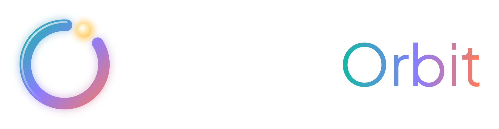
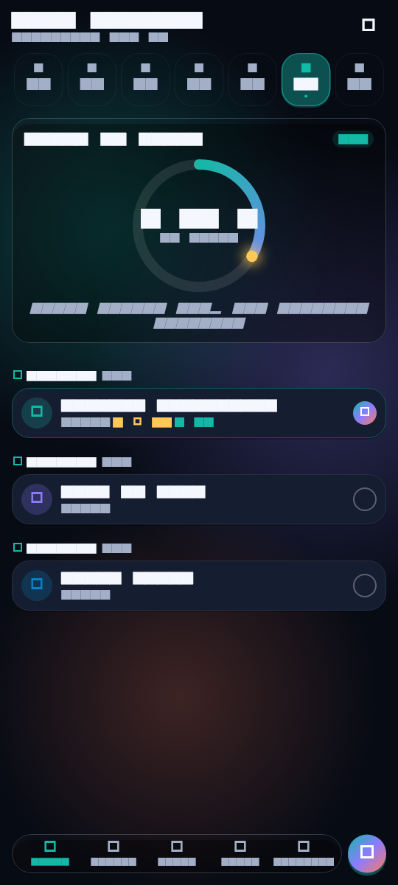
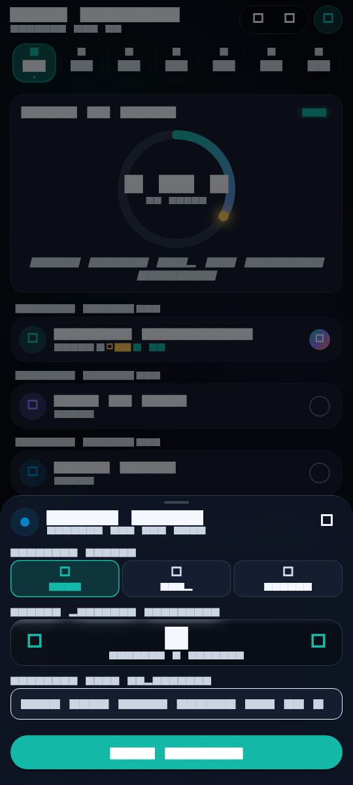
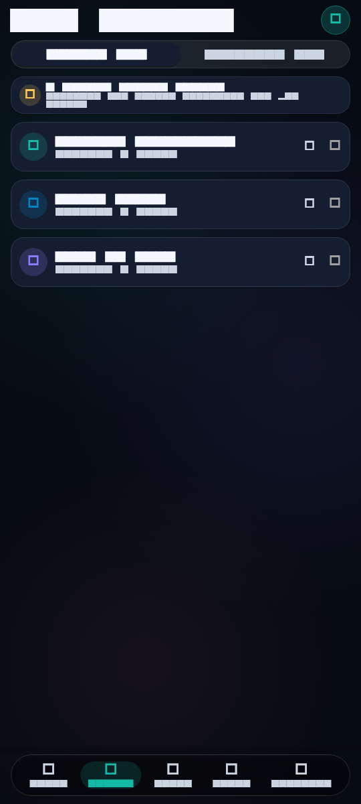
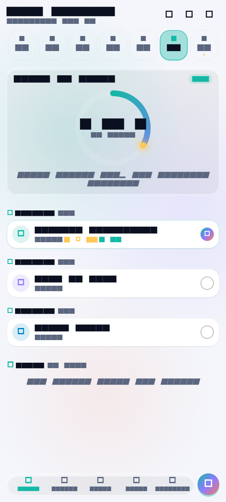
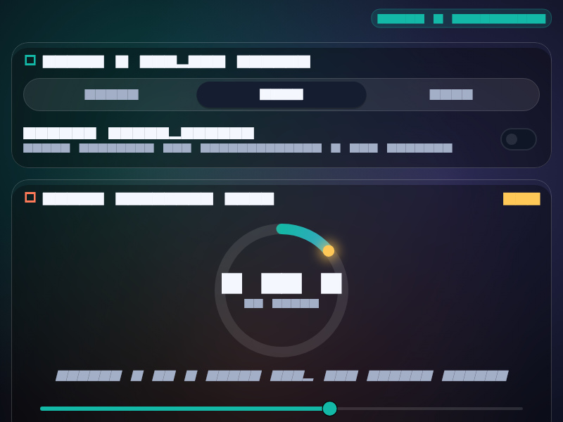
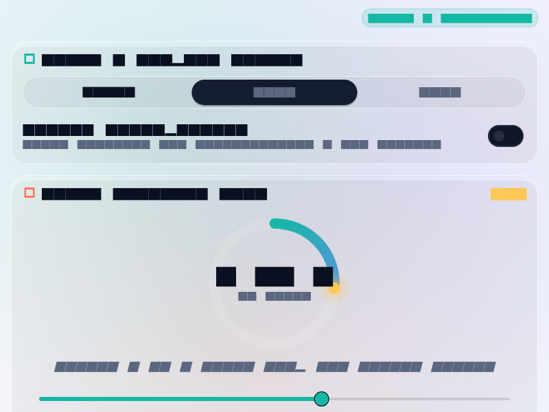
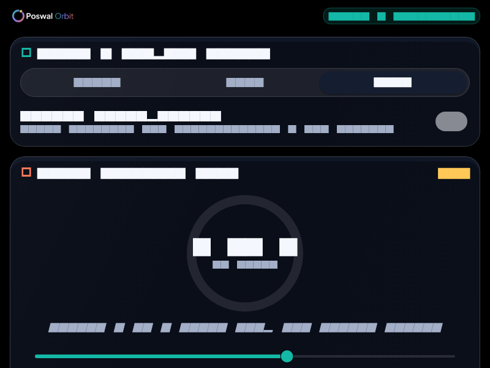

<p align="center">
  
</p>

<p align="center">
  <strong>Your whole day, in orbit.</strong><br>
  <em>Habits. Tasks. Notes. One private, calm, and beautiful place.</em>
</p>

<p align="center">
  <a href="https://github.com/officialtofeekposwal/poswal-orbit/releases"></a>
  <a href="LICENSE"></a>
  <a href="https://flutter.dev"></a>
  <a href="https://dart.dev"></a>
  <a href="https://github.com/officialtofeekposwal/poswal-orbit/actions/workflows/release.yml"></a>
  <a href="https://github.com/officialtofeekposwal/poswal-orbit/actions"></a>
  
  
  
</p>

---

## 🌟 Overview

**Poswal Orbit** is a 100% offline-first productivity hub for Android and iOS built with Flutter. It harmonizes daily habits, task checklists, and markdown notes into a unified, distraction-free environment rendered with a **Liquid Glass** aesthetic.

Unlike cloud trackers that demand account registrations, harvest personal data, or break when offline, Poswal Orbit operates entirely on your physical device. The `INTERNET` permission is completely omitted from the Android manifest—your habits, notes, and schedules never touch a remote server.

> [!TIP]
> **Quick Install:**
> Download the ready-to-run APK from our [Latest Release (v1.0.0)](https://github.com/officialtofeekposwal/poswal-orbit/releases/latest) or read the [Installation Guide](docs/INSTALL_DEBUG_APK.md).

---

## 📑 Table of Contents

- [Key Features](#-key-features)
- [Visual Tour](#-visual-tour)
- [Architecture & Tech Stack](#-architecture--tech-stack)
- [Security & Data Safety](#-security--data-safety)
- [Multilingual & True RTL](#-multilingual--true-rtl)
- [Android Home Screen Widgets](#-android-home-screen-widgets)
- [Getting Started & Local Setup](#-getting-started--local-setup)
- [Documentation Catalog](#-documentation-catalog)
- [Roadmap & Milestones](#-roadmap--milestones)
- [Contributing](#-contributing)
- [Third-Party Credits & License](#-third-party-credits--license)

---

## ✨ Key Features

### 💫 Unified Today Hub
- **Glance Progress Ring**: Dynamic, animated ring visualizing your daily completion momentum.
- **Combined Daily Stream**: Scheduled habits, tasks due today, and overdue items organized on a single calm canvas.
- **Floating Glass Navigation**: Responsive bottom navigation bar with adaptive pill indicators and fluid haptic feedback.

### 📈 Habit System & Deep Analytics
- **Exponential Consistency Scoring**: Intelligent EWMA scoring formula that rewards long-term consistency over fragile streaks.
- **Streak Preservation & Freeze**: Streak freezes, grace days, and non-destructive adjustments so life events don't wipe out your momentum.
- **14-Week GitHub-Style Heatmaps**: Interactive completion grids and year-long habit trend analysis.
- **Interactive Monthly Calendar**: Backfill, adjust, or view journal notes for past days with a single tap.
- **Long-Press Check-In Sheet**: Numeric stepper counters (+/-), skip toggles, and contextual journaling notes.

### ⚡ Tasks & Natural Language Quick-Add
- **Smart Quick-Add Engine**: Type naturally to create tasks with dates, times, priorities, and tags (e.g., `"Review quarterly budget tomorrow 4pm !urgent #finance"`).
- **Flexible Smart Lists**: Filter by *Today*, *Upcoming*, *Completed*, or custom project categories.
- **Subtasks & Recurrence**: Nested checklist items with live progress bars and repeating intervals (Daily, Weekly, Monthly).

### 📝 Markdown-Lite Notes & Global Search
- **Distraction-Free Editor**: Autosaving markdown workspace with floating glass formatting toolbar (headings, bold, lists, code, quotes).
- **Interactive Checklists**: Tap checkboxes directly within notes without switching into edit mode.
- **Unified Global Search**: Instant, zero-latency full-text search across habits, tasks, and notes with entity badge filters.

### 📊 Weekly Insights & Momentum
- **Guilt-Free Weekly Reviews**: Encouraging summary cards highlighting best streaks and productivity momentum.
- **Peak Performance Discovery**: Pure-Dart analytics identifying your most productive weekday and peak hourly focus windows.
- **Habit-Task Correlations**: Discovers synergies between your habits and completed tasks once sufficient history ($\ge 14$ days) is built.
- **Stats Card Sharing**: Render and share clean, privacy-redacted achievement stat cards via the native share sheet.

---

## 📱 Visual Tour

### Today Hub & Habit Analytics
| Today Hub (Dark) | Habit Detail (Dark) | Habit Check-In Sheet | Habits Management |
| :---: | :---: | :---: | :---: |
|  |  |  |  |

### Tasks Management & Natural Language Input
| Tasks List & Filters | Natural Language Quick-Add | Task Detail & Subtasks | Today Hub (Light) |
| :---: | :---: | :---: | :---: |
|  |  |  |  |

### Notes Workspace & Unified Search
| Notes Grid & Color Tags | Full-Screen Markdown Editor | Unified Multi-Entity Search | Create Habit Flow |
| :---: | :---: | :---: | :---: |
|  |  |  |  |

<details>
<summary><strong>View Theme System (Dark, Light, OLED Black)</strong></summary>

| Dark Theme (`#070B14`) | Light Theme (`#F4F6FB`) | True OLED Black (`#000000`) |
| :---: | :---: | :---: |
|  |  |  |

</details>

---

## 🛠️ Architecture & Tech Stack

```
lib/
├── core/            # Design tokens (poswal_tokens.dart), AppGlass surfaces, haptics, themes
├── data/            # Drift SQLite database, transactional migrations, repositories, backups
├── domain/          # Pure-Dart engines (streaks, EWMA score, NLP parser, insights, notifications)
└── features/        # Feature modules: Today, Habits, Tasks, Notes, Insights, Settings, Onboarding
```

- **Framework**: [Flutter 3.50.1](https://flutter.dev) (Impeller GPU rendering engine enabled)
- **State Architecture**: [Riverpod 2.x](https://riverpod.dev) with strict unidirectional state flow
- **Local Database**: [Drift](https://drift.simonbinder.eu) (Type-safe SQLite with transactional `SAVEPOINT` migrations)
- **Navigation**: [go_router](https://pub.dev/packages/go_router)
- **Local Notifications**: `flutter_local_notifications` + `timezone` (Battery-conscious 64-notification rolling window)
- **Security & Hardware Auth**: `local_auth` (Biometrics), `flutter_secure_storage`
- **Data Serialization**: [Freezed](https://pub.dev/packages/freezed) & `json_serializable`
- **Quality Gates**: Zero `flutter analyze` warnings, 164 automated tests (unit, repository, widget, text scaling, and screen-reader semantics).

---

## 🔒 Security & Data Safety

Poswal Orbit follows a strict **privacy-by-design** and **defense-in-depth** methodology:

1. **Zero Network Permissions**: The `android.permission.INTERNET` permission is excluded from the app manifest. The application cannot communicate with external servers under any condition.
2. **Biometric App Lock**: Secure your workspace via Fingerprint, Face Unlock, or system PIN/passcode fallback. Supports customizable auto-lock timeouts (*Immediate*, *30s*, *1m*, *5m*).
3. **Android Recent Apps Privacy Shield**: Dynamically toggles `WindowManager.LayoutParams.FLAG_SECURE` to blank out app preview screenshots in the Android task switcher and prevent unauthorized screen captures.
4. **Automated Daily Backups**: Atomic, rolling 7-day JSON snapshots stored locally with temporary-file write protection.
5. **Transactional Data Portability**: Full JSON export/import and standard CSV export/import (Habits, Check-ins, Tasks, Notes), plus one-click import from **Loop Habit Tracker** CSVs.
6. **Pre-Migration Safety Backups**: Automated physical file-copy snapshots (`.bak`) taken prior to running any database schema migrations.
7. **Read our full policy**: [PRIVACY.md](PRIVACY.md).

---

## 🌐 Multilingual & True RTL

Poswal Orbit features native, out-of-the-box support for three languages with zero runtime network font downloads:

- **English** (Default)
- **हिन्दी (Hindi)**: Bundled with [Noto Sans Devanagari](https://fonts.google.com/noto/specimen/Noto+Sans+Devanagari)
- **اردو (Urdu)**: Bundled with [Noto Nastaliq Urdu](https://fonts.google.com/noto/specimen/Noto+Nastaliq+Urdu) featuring authentic right-to-left (RTL) layout mirroring, directional padding (`EdgeInsetsDirectional`), and fluid typographic baselines.

Change languages anytime in **Settings > Appearance > Language**.

---

## 📱 Android Home Screen Widgets

Stay on top of your day without opening the app using native Android `AppWidgetProvider` widgets:
- **Today Progress Ring**: Real-time habit progress percentage and pending task counters.
- **Habit Check-Off Widget**: Tap a scheduled habit directly on your home screen to check it off with instant background database synchronization.
- **Task List Widget**: Scrollable list of pending and overdue tasks with priority badges.

---

## 🚀 Getting Started & Local Setup

### Prerequisites
- [Flutter SDK 3.24+](https://docs.flutter.dev/get-started/install) (Tested on Flutter 3.50.1 / Dart 3.14.0)
- Android Studio with Android SDK 34+ and Java 17
- *(Optional for iOS)* macOS with Xcode 15+ and CocoaPods (See [docs/IOS_STATUS.md](docs/IOS_STATUS.md))

### Step-by-Step Setup

1. **Clone the repository:**
   ```bash
   git clone https://github.com/officialtofeekposwal/poswal-orbit.git
   cd poswal-orbit
   ```

2. **Verify Flutter environment:**
   ```bash
   flutter doctor
   ```

3. **Install dependencies:**
   ```bash
   flutter pub get
   ```

4. **Run code generation (Drift database & Freezed models):**
   ```bash
   dart run build_runner build --delete-conflicting-outputs
   ```

5. **Run the automated test suite:**
   ```bash
   flutter test --no-test-assets
   ```

6. **Launch the application:**
   ```bash
   flutter run
   ```

*(Windows developers: consult [docs/WINDOWS_SETUP.md](docs/WINDOWS_SETUP.md) for Smart App Control and ADB troubleshooting).*

---

## 📚 Documentation Catalog

| Document | Description |
|---|---|
| [docs/RELEASING.md](docs/RELEASING.md) | Release keystore setup, Windows `keytool` instructions, and GitHub Actions release automation. |
| [docs/INSTALL_DEBUG_APK.md](docs/INSTALL_DEBUG_APK.md) | Step-by-step sideloading and ADB instructions for Android devices. |
| [docs/GOOD_FIRST_ISSUES.md](docs/GOOD_FIRST_ISSUES.md) | Curated, well-scoped starter issues for new open-source contributors. |
| [docs/IOS_STATUS.md](docs/IOS_STATUS.md) | Honest iOS hardware verification status and instructions for macOS developers. |
| [docs/WINDOWS_SETUP.md](docs/WINDOWS_SETUP.md) | Windows development guide (Smart App Control, impellerc, ADB setup). |
| [docs/PERFORMANCE.md](docs/PERFORMANCE.md) | Performance benchmarks, 60fps frame budget guidelines, and optimization notes. |
| [CHANGELOG.md](CHANGELOG.md) | Detailed version history following the Keep a Changelog standard. |
| [PRIVACY.md](PRIVACY.md) | Plain-language offline guarantee and zero-data-collection policy. |
| Store Listings | [English](docs/store/en.md) • [हिन्दी (Hindi)](docs/store/hi.md) • [اردو (Urdu)](docs/store/ur.md) |

---

## 🗺️ Roadmap & Milestones

- [x] **Phase 0: Design Foundations** — Design tokens, Liquid Glass wrappers (`AppGlass`), aurora ambient lighting, and playground.
- [x] **Phase 1: Habits Core & Today Hub** — Drift SQLite schema v1, streak engine, EWMA consistency scoring, and Today progress ring.
- [x] **Phase 1.5: Habit Analytics & Detail** — 14-week heatmaps, monthly calendar, numeric steppers, streak freeze, and reordering.
- [x] **Phase 2: Tasks Management** — Smart lists, priority matrix, subtask checklists, recurrence rules, and NLP quick-add.
- [x] **Phase 3: Notes & Global Search** — Markdown editor, autosave, checklist checkboxes, color tags, and unified search.
- [x] **Phase 4: Data Safety & Reminders** — 7-day automatic backup rotation, transactional JSON/CSV imports, Loop Habit Tracker migration, rolling notifications, and exact alarms.
- [x] **Phase 5A: Insights & Languages** — Guilt-free weekly reviews, peak focus hours, habit-task correlations, stats cards sharing, and English/Hindi/Urdu RTL.
- [x] **Phase 5B: Security & Home Widgets** — Biometric app lock, Android `FLAG_SECURE` recent apps shield, and home screen glance widgets.
- [x] **Phase 6: Polish & Open-Source Release** — Transactional migrations with `SAVEPOINT` rollback, screen-reader `Semantics` ($\ge 44\times 44$ tap targets), ProGuard/R8 shrinking, release workflows, and open-source documentation.

---

## 🤝 Contributing

We welcome community contributions, bug reports, and suggestions!
1. Check out our [Good First Issues](docs/GOOD_FIRST_ISSUES.md) for beginner-friendly tasks.
2. Read the [Releasing Guide](docs/RELEASING.md) to understand build and release standards.
3. Ensure all changes pass analysis and test gates:
   ```bash
   flutter analyze
   flutter test --no-test-assets
   ```
4. Open a pull request following standard conventional commits (`feat:`, `fix:`, `docs:`, `refactor:`).

---

## 📜 Third-Party Credits & License

- **Typography**:
  - [Plus Jakarta Sans](https://github.com/tokotype/PlusJakartaSans) by Tokotype (SIL Open Font License 1.1)
  - [Inter](https://github.com/rsms/inter) by Rasmus Andersson (SIL Open Font License 1.1)
  - [Noto Sans Devanagari](https://fonts.google.com/noto/specimen/Noto+Sans+Devanagari) by Google Fonts (SIL Open Font License 1.1)
  - [Noto Nastaliq Urdu](https://fonts.google.com/noto/specimen/Noto+Nastaliq+Urdu) by Google Fonts (SIL Open Font License 1.1)
- **Inspiration**: Built with respect for privacy-centric community trackers including Habo, Loop Habit Tracker, and Table Habit.
- **License**: Poswal Orbit is released under the [MIT License](LICENSE) © 2026 Poswal Orbit contributors.
