<a href="README.md">English</a> | <a href="README.hi.md">हिन्दी</a> | <b>اردو</b>

<h1 align="center">
<picture>
<source media="(prefers-color-scheme: dark)" srcset="assets/readme/hero-dark.svg">

</picture>
</h1>

عادتیں، کام اور نوٹس ایک پرسکون ایپ میں۔ سب کچھ آپ کے فون پر رہتا ہے۔

> [!NOTE]
> **تازہ ترین ریلیز: Beta 2 (v0.9.1)۔** تصدیق شدہ ریلیز APK براہِ راست [GitHub Releases](https://github.com/officialtofeekposwal/poswal-orbit/releases/tag/v0.9.1-beta.2) سے ڈاؤن لوڈ کریں یا نیچے دیے گئے [ڈاؤن لوڈ](#ڈاؤن-لوڈ) سیکشن کو دیکھیں۔

## یہ کیا ہے

Poswal Orbit فلٹر سے بنی آف لائن فرسٹ اینڈرائیڈ ایپ ہے۔ اس میں آپ کی عادتیں، آپ کے کام اور آپ کے نوٹس ایک ہی جگہ رہتے ہیں۔ کوئی اکاؤنٹ، سائن اِن یا سرور نہیں ہے۔

عادتیں آپ کا اندرونی مدار ہیں۔ کام بیرونی مدار ہیں۔ نوٹس وہ کششِ ثقل ہیں جو پورے دن کو تھامے رکھتی ہے۔

## Orbit کیوں

- **دن صبح 4:00 بجے شروع ہوتا ہے۔** رات میں 4 بجے سے پہلے کیا گیا چیک اِن پچھلے دن میں گنا جاتا ہے۔
- **یہ آف لائن چلتی ہے۔** نہ کچھ سنک کرنا ہے، نہ کسی کا انتظار۔
- **ہفتے کا جائزہ حوصلہ بڑھانے والے الفاظ میں ہوتا ہے۔**

## خصوصیات

- **آج۔** پروگریس رنگ دکھاتا ہے کہ دن کا کتنا حصہ مکمل ہوا۔ آج کی عادتیں اور کام ایک ہی فہرست میں ہیں۔
- **عادتیں۔** ہاں یا نہیں والی اور عددی عادتیں۔ پچھلے 14 ہفتوں کا ہیٹ میپ۔ اسٹریک فریز چھوٹے ہوئے دن کو بچا سکتا ہے۔
- **کام۔** سادہ جملے سے شامل کریں، جیسے `Pay rent tomorrow 4pm !high #home`۔ فہرستیں: Today, Upcoming, All اور Done۔ سب ٹاسک اور دہرانا۔
- **نوٹس۔** مارک ڈاؤن ایڈیٹر جو ٹائپ کرتے وقت انداز دکھاتا ہے۔ چیک لسٹ، رنگ ٹیگ، اور عادتوں، کاموں اور نوٹس میں ایک تلاش۔
- **انسائٹس۔** نیا ایپل HIG ڈیزائن: پروڈکٹیوٹی اسکور رنگ، ہفتہ وار چپس، 3-ٹیب نیویگیشن (Overview, Habits, Timing) اور کمپیکٹ ہیٹ میپ قطاریں۔
- **Obsidian والٹ سنک۔** مقامی دو طرفہ مارک ڈاؤن سنک (اینڈرائیڈ SAF کے ساتھ)۔ آپ کا ڈیٹا ہمیشہ محفوظ رہتا ہے۔

مکمل فہرست کے لیے [English README](README.md#features) دیکھیں۔

## رازداری

- ایپ کچھ بھی جمع نہیں کرتی۔ کوئی اکاؤنٹ، اینالیٹکس، اشتہار یا کریش رپورٹنگ نہیں ہے۔
- ریلیز بلڈ `INTERNET` اجازت نہیں مانگتے۔ ڈیبگ اور CI ٹیسٹ بلڈ مانگ سکتے ہیں۔
- ڈیٹا فون سے تبھی باہر جاتا ہے جب آپ خود اسے شیئر کریں۔

مکمل متن [PRIVACY.md](PRIVACY.md) میں ہے (انگریزی میں)۔

## زبانیں

English، हिन्दी اور اردو۔ اردو میں لے آؤٹ دائیں سے بائیں چلتا ہے۔ زبان بدلنے کے لیے **Settings > Language** کھولیں۔

## ڈاؤن لوڈ

تازہ ترین تصدیق شدہ ریلیز APK براہِ راست ڈاؤن لوڈ کریں:

یا تمام ریلیزز [Releases صفحہ](https://github.com/officialtofeekposwal/poswal-orbit/releases) پر دیکھیں۔

### انسٹال کرنے کا طریقہ:
1. اوپر دیے گئے **APK ڈاؤن لوڈ کریں** بٹن پر ٹیپ کریں۔
2. ڈاؤن لوڈ مکمل ہونے پر نوٹیفکیشن یا فائل مینیجر سے فائل کھولیں۔
3. اینڈرائیڈ پوچھے تو انسٹال کرنے کی اجازت دیں۔
4. **Install** پر ٹیپ کر کے Poswal Orbit شروع کریں۔

## حالت

| شعبہ | حالت |
| :--- | :--- |
| اینڈرائیڈ ریلیز بلڈ | شائع شدہ ([Beta 2 v0.9.1](https://github.com/officialtofeekposwal/poswal-orbit/releases/tag/v0.9.1-beta.2)) |
| اینڈرائیڈ ڈیبگ بلڈ (CI) | تیار، 245 خودکار ٹیسٹ پاس |
| Obsidian والٹ سنک | مکمل اور تصدیق شدہ |
| ریمائنڈرز، الارم، وجٹس | لکھے گئے اور مقامی طور پر جانچے گئے |

| شعبہ | حالت |
| :--- | :--- |
| اینڈرائیڈ ڈیبگ بلڈ (CI) | بن گیا، خودکار ٹیسٹ پاس |
| اینڈرائیڈ ریلیز بلڈ | CI میں بن گیا، فون پر جانچ باقی |
| اصل فون پر جانچ | جاری ہے |
| یاد دہانیاں، الارم، ویجیٹ | لکھے گئے ہیں، ابھی کسی ڈیوائس پر جانچے نہیں گئے |
| iOS | کوڈ لکھا ہے، جانچا نہیں گیا (Mac دستیاب نہیں) |
| Play Store | شائع نہیں ہوا |

## تعاون اور لائسنس

بلڈ، آرکیٹیکچر اور ٹیسٹ کی معلومات [English README](README.md#build-from-source) میں ہیں۔ آغاز کے لیے [docs/GOOD_FIRST_ISSUES.md](docs/GOOD_FIRST_ISSUES.md) اور [CONTRIBUTING.md](CONTRIBUTING.md) دیکھیں۔

Poswal Orbit [MIT لائسنس](LICENSE) کے تحت جاری ہے۔

